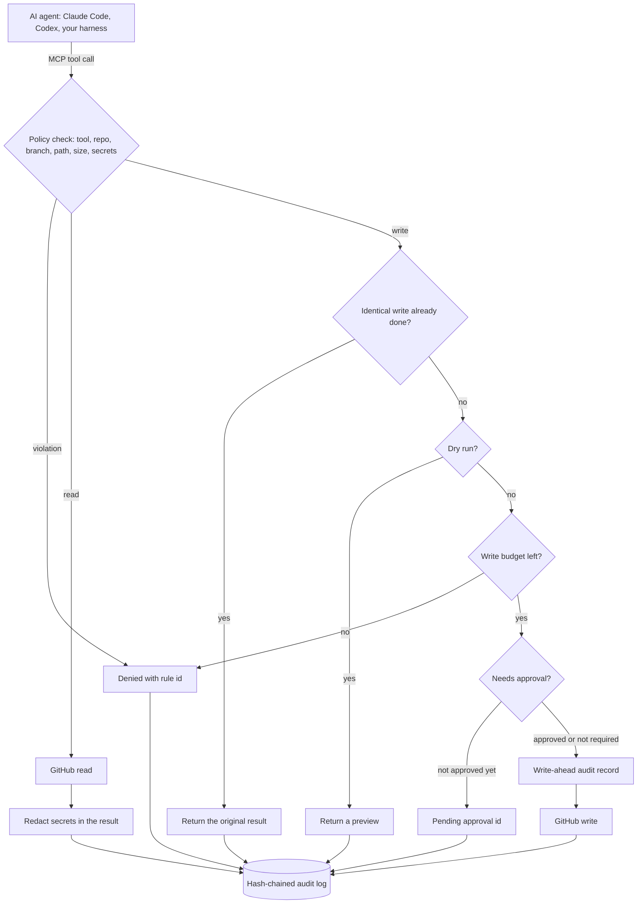

# guardrail-mcp

**A policy-enforced MCP server that gives AI coding agents scoped, audited access to GitHub.**

[](https://github.com/azambd/guardrail-mcp/actions/workflows/ci.yml)


Hand an agent a GitHub token and it can do everything that token can do. guardrail-mcp sits between the agent and GitHub and answers three questions on every single call:

1. **Is the agent allowed to do this?** A YAML policy decides, and anything not allowed is denied.
2. **What exactly did it do?** Every call, including the denied ones, lands in a hash-chained audit log.
3. **Can a human stop it first?** Risky tools pause until someone approves that exact action.

It works with Claude Code, Codex, Claude Desktop or your own agent harness, because it speaks plain MCP.

## See it in 60 seconds

No token, no network. The demo runs a scripted agent session against an in-memory GitHub:

```bash
git clone https://github.com/azambd/guardrail-mcp && cd guardrail-mcp
python -m venv .venv && source .venv/bin/activate
pip install -e .
guardrail-mcp demo
```

```
  agent → describe_permissions()                               [ALLOW]     15 tools allowed, 1 gated, 1 hidden
  agent → list_issues()                                        [ALLOW]     3 open issues
  agent → get_file(path="config/settings.py")                  [ALLOW]     1 credential redacted before reaching the model
  agent → get_file(path=".env")                                [DENY]      paths.deny_read
  agent → create_issue(repo="acme/billing")                    [DENY]      repos.allow
  agent → commit_file(branch="main", path="src/checkout.py")   [DENY]      branches.protected
  agent → create_branch(branch="agent/fix-double-submit")      [ALLOW]     branch created from main
  agent → commit_file(path=".github/workflows/deploy.yml")     [DENY]      paths.deny_write
  agent → commit_file(path="src/checkout.py")                  [ALLOW]     commit ed5afd8 on agent/fix-double-submit
  agent → comment_on_issue(number=1, body="...ghp_ZZZZ...")    [DENY]      content.block_secrets
  agent → open_pull_request(dry_run=true)                      [DRY RUN]   preview returned, nothing changed
  agent → open_pull_request(head="agent/fix-double-submit")    [ALLOW]     PR #4 opened as draft (policy)
  agent → open_pull_request(...)  # agent retries              [REPLAY]    original result returned, no duplicate PR
  agent → close_issue(number=1)                                [APPROVAL]  paused, request apr_c6214176 waits for a human
  human → guardrail-mcp approvals approve apr_c6214176         [APPROVED]  single use, logged with who approved
  agent → close_issue(number=1)  # same args                   [ALLOW]     issue #1 is closed
  agent → merge_pull_request(number=4)                         [HIDDEN]    not exposed by policy, the agent cannot see or call it
  agent → get_ci_status(ref="main")                            [ALLOW]     failure: unit-tests (run 9001)

  6 actions blocked before reaching GitHub, 5 real API writes performed.
  audit log: 22 records, hash chain intact
```

## What it stops

| Guardrail | What it prevents |
|---|---|
| Repository allow and deny lists | Work outside the repos you approved |
| Tool allowlist; unlisted tools are never registered | Merging, or any tool you did not enable. The agent cannot call what it cannot see |
| Agent branch prefix plus protected branches | Commits to `main` or release branches |
| Write path rules | Edits to CI workflows. An agent that can edit CI can grant itself new powers |
| Read path rules | `.env` files and keys reaching the model |
| Secret scanning on writes | Credentials pasted into issues, comments or commits |
| Secret redaction on reads | Credentials already in the repo reaching the model's context |
| Human approval gate | Irreversible actions without sign-off. Approvals are bound to the exact arguments, single use and expiring |
| Dry run, per call or global | Surprises. The agent sees exactly what would happen first |
| Idempotent replay | Duplicate issues and PRs when an agent retries after a timeout |
| Per-session write budget | Runaway loops |
| Forced draft pull requests | Unreviewed code heading for `main` |
| Write-ahead audit log | Actions with no record. If the intent cannot be logged, the write does not happen |

Every denial comes back to the agent with a stable rule id (`repos.allow`, `branches.protected`, ...) and an instruction not to work around it, so the agent explains the block instead of trying another route.

## How it works



The code is split so each concern is testable on its own:

```
src/guardrail_mcp/
  catalog.py      tool metadata: which args name a repo, branch, path or free text
  policy.py       strict YAML policy model (unknown keys and tool names are errors)
  guard.py        the decision pipeline above
  audit.py        append-only, hash-chained JSONL with verification and file locking
  state.py        SQLite store for approvals and idempotency
  scanning.py     secret detection and redaction
  github.py       REST client with retry rules that never duplicate a write
  tools.py        the 18 MCP tools
  server.py       wires it together; only enabled tools are registered
  cli.py          serve, check, doctor, approvals, audit, demo
  fake_github.py  in-memory GitHub for the demo and tests
```

## Use it with your repositories

**1. Create a fine-grained GitHub token** limited to the repositories the agent should touch. The token is the hard ceiling; the policy narrows it further. Give it only what your enabled tools need: Metadata (read), Contents (read and write), Issues (read and write), Pull requests (read and write), Checks (read), and Actions (read and write) only if you enable `rerun_failed_jobs`.

**2. Write a policy.**

```bash
cp policy.example.yaml policy.yaml   # then set repos.allow
guardrail-mcp check --policy policy.yaml
```

```yaml
repos:
  allow: [your-org/your-repo]
tools:
  allow: [get_repo, list_issues, get_issue, get_file, get_ci_status,
          create_branch, commit_file, open_pull_request, comment_on_issue]
  require_approval: [close_issue]
branches:
  agent_prefix: "agent/"
  protected: ["main", "release/*"]
paths:
  deny_write: [".github/workflows/**", ".env", ".env.*", "**/*.pem"]
limits:
  max_writes_per_session: 25
```

**3. Check the connection** with a live, read-only pass through the real tool path:

```bash
export GITHUB_TOKEN=github_pat_...
guardrail-mcp doctor --policy policy.yaml
```

**4. Connect your agent.**

Claude Code, in `.mcp.json` at your project root:

```json
{
  "mcpServers": {
    "github-guarded": {
      "command": "/absolute/path/to/.venv/bin/guardrail-mcp",
      "args": ["serve", "--policy", "/absolute/path/to/policy.yaml", "--agent-id", "claude-code"],
      "env": { "GITHUB_TOKEN": "${GITHUB_TOKEN}" }
    }
  }
}
```

Codex, in `~/.codex/config.toml`:

```toml
[mcp_servers.github-guarded]
command = "/absolute/path/to/.venv/bin/guardrail-mcp"
args = ["serve", "--policy", "/absolute/path/to/policy.yaml", "--agent-id", "codex"]
env = { GITHUB_TOKEN = "github_pat_..." }
```

Any MCP client over HTTP:

```bash
guardrail-mcp serve --policy policy.yaml --transport streamable-http --port 8000
# endpoint: http://127.0.0.1:8000/mcp
```

The HTTP transport has no authentication of its own. Keep it on localhost or put it behind an authenticating proxy.

Give the agent no other GitHub credentials (no `gh` login, no stored git push credentials). A guardrail only works if it is the only door.

## Human approvals

```
agent  close_issue(number=1)
       -> APPROVAL REQUIRED: request apr_c6214176 is pending. Ask the user to run
          `guardrail-mcp approvals approve apr_c6214176`, then call close_issue again
          with exactly the same arguments.

you    guardrail-mcp approvals list
you    guardrail-mcp approvals approve apr_c6214176

agent  close_issue(number=1)        # same arguments
       -> ok
```

Approval happens out of band, from a terminal the agent does not control, and the server exposes no tool for approving. An approval is bound to the hash of the exact arguments, so approving "close #1" cannot be used to close #2. It works once and expires after `approval_ttl_seconds`. Who approved, and what, goes into the audit log.

## The audit log

One JSON object per line. A write produces an `intent` record before the call and a `result` record after it:

```json
{
  "seq": 11,
  "ts": "2026-11-02T00:21:18.014Z",
  "session": "s_1a0acd0e",
  "agent": "claude-code",
  "request_id": "11",
  "tool": "commit_file",
  "kind": "write",
  "repo": "acme/web-app",
  "args": {
    "branch": "agent/fix-double-submit",
    "path": "src/checkout.py",
    "content": { "bytes": 86, "sha256": "6d5f094c6ea5..." },
    "message": "Make order submission idempotent (#1)"
  },
  "decision": "allow",
  "phase": "intent",
  "prev": "6402e3ea9044...",
  "hash": "5a15f440a5f8..."
}
```

Secrets are redacted before anything is written, long text is truncated, and file contents are stored as a size and hash rather than copied. Decisions include `allow`, `deny` (with the rule id), `dry_run`, `replayed`, `approval_required`, `approval_granted`, `approval_denied` and `redacted`.

```bash
guardrail-mcp audit tail -n 50 --policy policy.yaml
guardrail-mcp audit verify --policy policy.yaml   # exits 1 if any record was edited, removed or reordered
```

**OpenTelemetry.** The MCP Python SDK opens a span for every tool call. guardrail-mcp adds a `guardrail.decision` event to that span with the tool, decision, rule and repository, so with an OpenTelemetry SDK and exporter configured in the process, policy decisions show up next to the rest of your traces.

## Tools

| Tool | Type | Notes |
|---|---|---|
| `describe_permissions` | meta | Always available. Tells the agent what it may and may not do, and its remaining write budget |
| `get_repo` | read | Default branch, visibility, open issues |
| `list_issues`, `get_issue` | read | Pull requests filtered out; recent comments included |
| `search_code` | read | Needs an authenticated token |
| `get_file` | read | Files or directories; denied paths blocked, secrets redacted |
| `list_pull_requests`, `get_pull_request` | read | Includes changed files |
| `get_ci_status` | read | Overall result, failing checks and Actions run ids |
| `create_issue`, `comment_on_issue`, `add_labels` | write | Text scanned for credentials |
| `close_issue` | write | Typically behind approval |
| `create_branch`, `commit_file` | write | Agent branches only; path rules apply |
| `open_pull_request` | write | Head must be an agent branch; base must be allowed; draft can be forced |
| `merge_pull_request` | write | Off by default. If you enable it, put it behind approval |
| `rerun_failed_jobs` | write | Re-runs failed jobs of an Actions run |

## Security model and honest limits

- **The token is the real boundary.** The policy can only narrow what the token allows. Use a fine-grained token scoped to specific repositories.
- **The server must be the only route to GitHub.** An agent with a shell and `gh` credentials can bypass any MCP-level control.
- **Secret detection is pattern based.** It catches common token formats (GitHub, AWS, Anthropic, OpenAI, Slack, JWTs, private keys), not every secret. Add your own formats under `content.extra_secret_patterns`.
- **The audit log is tamper-evident, not tamper-proof.** Editing, deleting or reordering a record is detected, but someone with write access could rewrite the entire chain or cut off the tail. Ship the log to storage the agent host cannot modify if that matters to you.
- **The write budget is per server process.** One stdio process is one agent session.

## Development

```bash
pip install -e ".[dev]"
pytest
```

80 tests run with no network. The suite drives the server through a real MCP client against an in-memory GitHub that records every request, so it can prove that denied, dry-run and replayed calls never reach the API. It also launches the actual `guardrail-mcp serve` process over stdio, and checks the GitHub client's retry rules (a `POST` that hit a 5xx is reported, never blindly repeated).

## Roadmap

- Jira and Linear adapters behind the same guard. The guard is provider-agnostic: tools only declare which arguments name a project, branch, path or free text.
- Inline approvals through MCP elicitation for clients that support it, keeping the CLI as the out-of-band path.
- Per-tool rate limits and time windows.
- Signed audit checkpoints shipped to object storage.

## About

Built by [Faruque Azam](https://github.com/azambd), founder of [Webtario](https://webtario.com). We build production data pipelines and AI agent integrations. If you are putting agents into real workflows and need them to be safe to run, get in touch.

MIT licensed.
